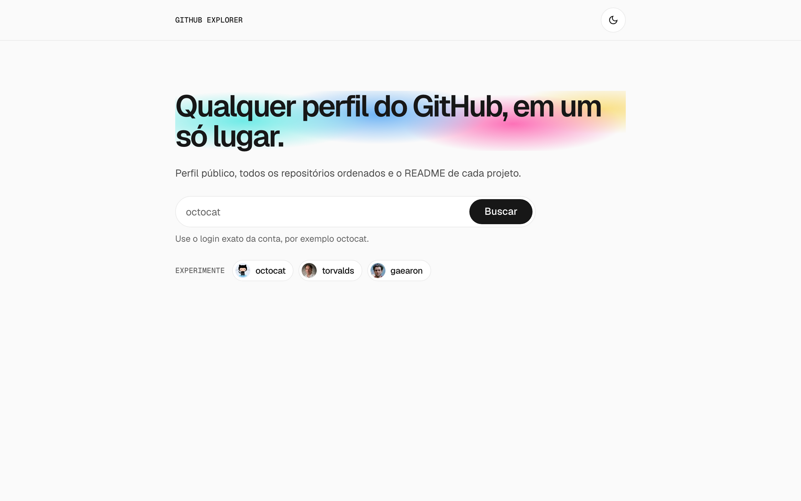
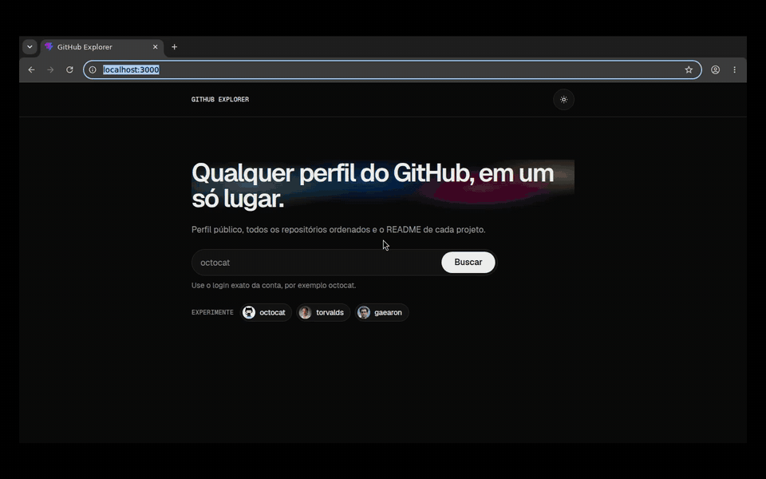
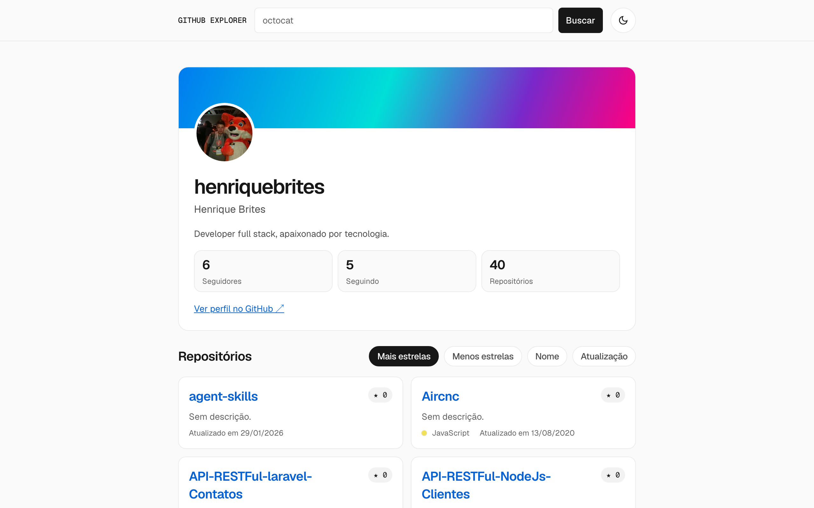
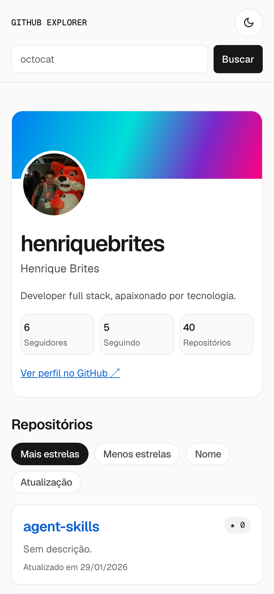
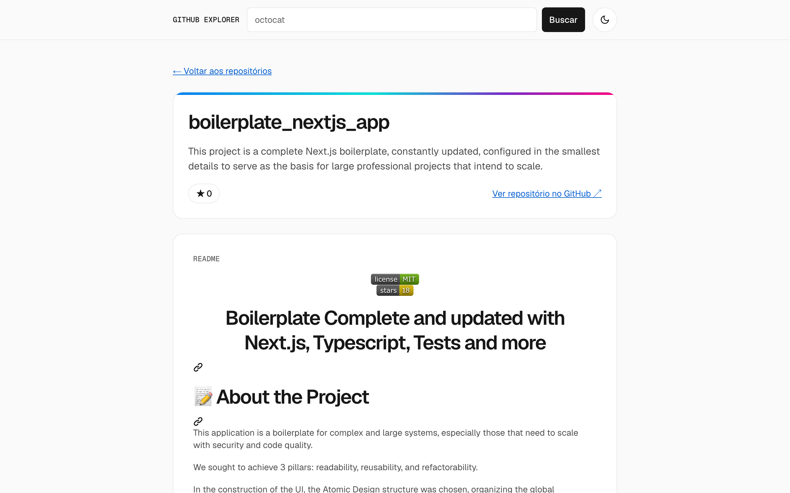

<div align="center">

# GitHub Explorer

**Qualquer perfil do GitHub, em um só lugar.**

Busque um usuário, veja o perfil público, navegue pelos repositórios ordenados
e leia o README de cada projeto, sem token e sem backend.

[](https://github.com/henriquebrites/gitscope/actions/workflows/ci.yml)     

<p><a href="https://gitscope-rouge.vercel.app"></a> <a href="#demo"></a> <a href="#funcionalidades"></a> <a href="#como-rodar"></a> <a href="#stack"></a> <a href="#decisões-relevantes"></a></p>

<picture>
  <source media="(prefers-color-scheme: dark)" srcset="docs/screenshots/home-dark.png">
  
</picture>

</div>

## Demo

O vídeo abaixo mostra o fluxo principal: buscar um usuário, ordenar os
repositórios por nome e abrir o detalhe de um deles com o README renderizado.

<p align="center">
  <a href="docs/demo/search-to-repository.mp4">
    
  </a>
  <br>
  <sub><a href="docs/demo/search-to-repository.mp4">Ver o vídeo em MP4 (1440 × 900)</a></sub>
</p>

## Telas

As imagens abaixo seguem o tema do seu GitHub: claro ou escuro, como a própria
aplicação.

<table>
  <tr>
    <td width="66%">
      <picture>
        <source media="(prefers-color-scheme: dark)" srcset="docs/screenshots/profile-dark.png">
        
      </picture>
      <p align="center"><b>Perfil e repositórios</b></p>
    </td>
    <td width="34%">
      <picture>
        <source media="(prefers-color-scheme: dark)" srcset="docs/screenshots/profile-mobile-dark.png">
        
      </picture>
      <p align="center"><b>Mobile</b></p>
    </td>
  </tr>
  <tr>
    <td colspan="2">
      <picture>
        <source media="(prefers-color-scheme: dark)" srcset="docs/screenshots/repository-dark.png">
        
      </picture>
      <p align="center"><b>Detalhe do repositório com o README</b></p>
    </td>
  </tr>
</table>

## Funcionalidades

A aplicação cobre a busca, o perfil, a lista e o detalhe de repositórios, com
estados de carregamento, erro e vazio em cada tela.

- **Busca de usuário:** um único campo por tela, no destaque da página inicial
  (com três contas de exemplo) ou no cabeçalho. Espaços extras são removidos,
  entrada vazia é recusada com orientação e o envio fica desabilitado enquanto
  o perfil carrega.
- **Perfil público:** capa, avatar, login, nome, bio, e-mail público, link para
  o GitHub e três métricas. Campos ausentes são omitidos, nunca exibidos como
  `null`.
- **Lista de repositórios:** todas as páginas da API carregadas antes da
  exibição, ordenação por estrelas, nome ou última atualização e paginação de
  30 itens.
- **Detalhe do repositório:** nome, descrição, estrelas, linguagem e o README
  sanitizado. A rota abre por link direto ou refresh, e o link de volta restaura
  a ordenação e a página da lista.
- **Tema claro e escuro:** segue o sistema até você escolher um pelo
  cabeçalho; a escolha fica salva e vale desde o primeiro quadro, sem piscar.
- **Tratamento de falhas:** mensagens específicas para conta ou repositório não
  encontrado, falha de rede, limite da API (com o horário de liberação) e erro
  inesperado. Uma falha nos repositórios não esconde o perfil, e uma falha no
  README não esconde o detalhe.
- **Acessibilidade e responsividade:** funciona a partir de 320 × 480 px sem
  rolagem horizontal, com foco visível, navegação por teclado e regiões
  `aria-live` e `role="alert"`.

## Como rodar

Você roda o projeto localmente com Node.js e npm. A aplicação não precisa de
variáveis de ambiente nem de token do GitHub.

<!-- prettier-ignore -->
> [!IMPORTANT]
> Você precisa do **Node.js 22.12 ou mais recente** (22.x a partir de 22.12, ou
> 24.x), exigência do Vitest 5. O projeto foi desenvolvido e roda no CI com
> Node.js 24.

Para subir a aplicação a partir de um clone novo, siga estas etapas:

1.  Clone o repositório e entre na pasta:

    ```bash
    git clone https://github.com/henriquebrites/gitscope.git
    cd gitscope
    ```

2.  Instale as dependências:

    ```bash
    npm install
    ```

3.  Inicie o servidor de desenvolvimento:

    ```bash
    npm run dev
    ```

4.  Abra `http://localhost:5173` e busque um login, por exemplo `octocat`.

<!-- prettier-ignore -->
> [!NOTE]
> Todas as chamadas são anônimas, então valem os limites públicos da API do
> GitHub: 60 requisições por hora por IP. Se o limite acabar, a tela informa o
> horário de liberação.

### Comandos

Todos os comandos rodam na raiz do projeto.

| Comando | O que faz |
| --- | --- |
| `npm run dev` | Inicia o servidor de desenvolvimento do Vite em `http://localhost:5173`. |
| `npm test` | Roda os testes unitários e de componentes (Vitest + React Testing Library, jsdom). |
| `npm run test:e2e` | Gera o build, sobe o `vite preview` na porta 4173 e roda a suíte Playwright no Chromium. |
| `npm run lint` | Roda o ESLint em todo o projeto. |
| `npm run build` | Verifica os tipos (`tsc -b`) e gera o build de produção em `dist/`. |
| `npm run preview` | Serve o build de `dist/` localmente. |

Antes do primeiro `npm run test:e2e`, instale o Chromium do Playwright:

```bash
npx playwright install chromium
```

<!-- prettier-ignore -->
> [!TIP]
> Os testes nunca acessam a API real. No Vitest, o `fetch` recebe respostas
> simuladas; no Playwright, `page.route` atende cada chamada a
> `https://api.github.com`, e uma proteção em `tests/support/test.ts` reprova
> qualquer requisição externa que nenhum teste tenha interceptado. O mesmo
> conjunto (lint, testes, build e E2E) roda no GitHub Actions a cada pull
> request.

## Stack

A aplicação usa React com TypeScript, empacotada pelo Vite. As versões abaixo
são as instaladas pelo `package-lock.json`.

| Uso | Ferramenta | Versão |
| --- | --- | --- |
| Interface | React e React DOM | 19.3.0 |
| Linguagem | TypeScript | 6.0.3 |
| Build e servidor de desenvolvimento | Vite | 8.3.4 |
| Rotas | React Router DOM (data mode, sem loaders) | 7.18.4 |
| Estilo | Tailwind CSS (com `@tailwindcss/vite`) | 4.3.3 |
| Fontes auto-hospedadas | `@fontsource-variable/geist` e `geist-mono` | 5.3.0 |
| Sanitização do README | DOMPurify | 3.4.17 |
| Testes unitários e de componentes | Vitest, React Testing Library e jsdom | 5.0.4, 16.3.3, 30.1.2 |
| Testes end-to-end | Playwright (Chromium) | 1.64.0 |
| Lint | ESLint | 10.12.0 |
| CI | GitHub Actions | — |

O estado compartilhado usa Context API com `useReducer`, e as chamadas HTTP
usam a Fetch API. Todo HTML de README passa pelo DOMPurify, que remove scripts,
iframes, estilos, formulários e atributos de evento; links externos abrem em
nova aba com `noopener`.

## Estrutura de pastas

O código separa páginas, componentes de apresentação, integração com a API,
estado compartilhado, tipos e utilitários.

```text
src/
  app/          rotas (data mode) e App; testes de rota com createMemoryRouter
  components/
    feedback/   conteúdo de erro compartilhado entre as telas
    layout/     cabeçalho, botão de tema, layout e container de página
    profile/    cartão, skeleton e erros do perfil
    repositories/  lista, item, ordenação, paginação, detalhe e README
    search/     formulário de busca
  context/      GitHubContext, provider e reducer (cache em memória)
  hooks/        useProfile, useRepositories, useRepository e useReadme
  pages/        HomePage, UserPage, RepositoryPage, NotFoundPage, RouteErrorPage
  services/     githubApi: URLs, fetch, paginação e erros de domínio
  theme/        tema claro ou escuro: escolha salva e preferência do sistema
  types/        tipos da API e do domínio
  utils/        ordenação, formatação pt-BR, paginação, query da lista, cores
                de linguagem e sanitização do README
  test/         setup do Vitest e testes de tokens e camadas
tests/          specs Playwright e stubs da API (tests/support/)
```

## Decisões relevantes

Estas decisões definem o comportamento da aplicação e explicam escolhas que
não ficam evidentes só pelo código.

- **A URL é a fonte de verdade.** Usuário, repositório, ordenação e página vêm
  da rota (`/users/:username`, `/users/:username/repos/:repoName`,
  `?sort=&page=`), então qualquer rota funciona em acesso direto e refresh.
  Valores inválidos de `sort` voltam para estrelas decrescentes, e uma `page`
  inválida volta para 1.
- **A lista só é exibida completa.** A API não ordena por estrelas, então as
  páginas (100 itens cada) são buscadas em sequência pelo cabeçalho `Link` com
  `rel="next"`. Se qualquer página falhar, a seção inteira entra em erro, sem
  lista parcial.
- **Erros de domínio, sem retentativa automática.** O serviço converte cada
  falha em `not-found`, `network`, `rate-limited` ou `unexpected`. Toda nova
  tentativa é uma ação do usuário, e com o limite atingido não há botão de
  tentar novamente.
- **Cache só em memória.** Perfil, repositórios e README ficam em um reducer
  chaveado pelo login em minúsculas, para que voltar a um perfil não gaste
  requisições. O cache se perde no refresh e nunca é requisito.
- **Sem token.** Todas as chamadas são GETs anônimos a
  `https://api.github.com`, sem `Authorization` nem segredo no código. Por isso
  os repositórios só são buscados depois que o perfil existe.

<details>
<summary><b>Mais decisões: respostas obsoletas, README e tema</b></summary>

- **Respostas obsoletas são descartadas.** Ao trocar de usuário ou sair da
  tela, as requisições em curso são canceladas com `AbortController`, e nenhum
  dado de outro usuário aparece como atual.
- **O README é um domínio de falha próprio.** Ele é pedido com
  `Accept: application/vnd.github.html+json` só depois que o repositório está
  na tela, e a falha dele nunca esconde o detalhe. Um repositório sem README
  (`404`) é um estado vazio, não um erro. O README e a ausência dele ficam no
  cache; as falhas não, para que reabrir o repositório tente de novo.
- **O tema troca valores, não componentes.** Um script no `index.html` grava
  `light` ou `dark` no atributo `data-theme` do `<html>` antes da primeira
  pintura, e o tema escuro redefine os mesmos tokens de cor. Nenhum componente
  usa a variante `dark:`. A escolha fica em
  `localStorage["github-explorer:theme"]`; sem ela, o tema segue o sistema.

</details>

<details>
<summary><b>Ajustes de tokens visuais para WCAG AA</b></summary>

Os tokens visuais seguem o design system da Vercel (Geist), mapeados no
`@theme` do Tailwind em `src/index.css`. No tema claro, seis tokens de cor de
texto foram escurecidos para atingir contraste WCAG AA de 4,5:1 sobre os
fundos usados. O tema escuro, que o design system não define, redefine os
tokens abaixo em `:root[data-theme='dark']`; todo token de texto escuro também
passa de 4,5:1 sobre `canvas`, `canvas-elevated` e `hairline-soft`.

| Token | Original | Claro (ajustado) | Escuro |
| --- | --- | --- | --- |
| `mute` | `#8f8f8f` | `#636363` | `#8f8f8f` |
| `faint` | `#a1a1a1` | `#6b6b6b` | `#8a8a8a` |
| `link` | `#0070f3` | `#0761d1` | `#52a8ff` |
| `link-deep` | `#0761d1` | `#0550b0` | `#7bbcff` |
| `error` | `#ee0000` | `#c50000` | `#ff6166` |
| `error-deep` | `#c50000` | `#a30000` | `#ff8a8f` |
| `canvas` | `#fafafa` | `#fafafa` | `#0a0a0a` |
| `canvas-elevated` | `#ffffff` | `#ffffff` | `#141414` |
| `hairline` | `#ebebeb` | `#ebebeb` | `#2a2a2a` |
| `hairline-soft` | `#f2f2f2` | `#f2f2f2` | `#1f1f1f` |
| `ink` | `#171717` | `#171717` | `#ededed` |
| `body` | `#4d4d4d` | `#4d4d4d` | `#a1a1a1` |
| `warning-deep` | `#ab570a` | `#ab570a` | `#f5a623` |
| `primary` | `#171717` | `#171717` | `#ededed` |
| `on-primary` | `#ffffff` | `#ffffff` | `#0a0a0a` |
| `focus` (= `link`) | `#0070f3` | `#0761d1` | `#52a8ff` |

As cores de gradiente não mudam entre os temas e ficam só na capa do perfil,
no fio do detalhe e no brilho atrás do título da página inicial, nunca atrás
de texto corrido.

</details>

<details>
<summary><b>Medir com o Lighthouse</b></summary>

O Lighthouse não é uma dependência do projeto. Ele roda pelo `npx` e exige
Node.js 22.19 ou mais recente e o Google Chrome instalado. Para medir o build
em modo mobile, siga estas etapas:

1.  Gere e sirva o build:

    ```bash
    npm run build
    npm run preview
    ```

2.  Em outro terminal, rode o Lighthouse uma vez em cada tema. A opção
    `preferredColorScheme` emula `prefers-color-scheme` (`1` claro, `0`
    escuro):

    ```bash
    mkdir -p lighthouse
    npx lighthouse@13.5.0 http://localhost:4173/ --form-factor=mobile \
      --output=json --output=html --output-path=./lighthouse/home-light \
      --chrome-flags="--headless=new --blink-settings=preferredColorScheme=1"
    npx lighthouse@13.5.0 http://localhost:4173/ --form-factor=mobile \
      --output=json --output=html --output-path=./lighthouse/home-dark \
      --chrome-flags="--headless=new --blink-settings=preferredColorScheme=0"
    ```

Os relatórios ficam em `lighthouse/`, pasta ignorada pelo Git. A última
medição, em 14 de outubro de 2026, deu:

| Tema | Performance | Accessibility | Best Practices | SEO |
| --- | --- | --- | --- | --- |
| Claro | 95 | 100 | 100 | 83 |
| Escuro | 98 | 100 | 100 | 83 |

</details>

## Próximos passos

Experimente a [demo publicada](https://gitscope-rouge.vercel.app) ou rode
`npm run dev` e busque um login. Para conferir a entrega, rode `npm test`,
`npm run test:e2e` e `npm run build`.
